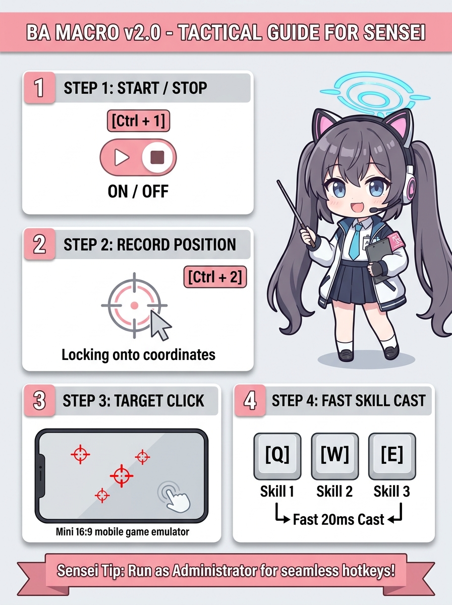

# 😭 BAMacro v2.0 - Tool Giúp Sensei Bấm Chuột Hộ

> *"Ủa alo, chơi Blue Archive mà bắt bấm skill nhanh bằng cơm à? Tay đâu mà lia kịp, nhường việc bấm chuột cho tool đê!"* - Một Sensei lười biếng nào đó cho hay.

<p align="center">
  
  <br>
  <b>Oh my Gotto! Sao lại bấm trượt skill nữa rồi?! 💥</b>
</p>

---

## 🌟 Cái này là cái gì?

Đây là phần mềm macro hỗ trợ Sensei chơi **Blue Archive** trên PC (giả lập hoặc PC client) đỡ đau tay, chống tiền đình, không lo bấm trượt skill lúc đánh Boss/Tổng Lực Chiến (Raid).

Giao diện màu hồng pastel cute phô mai que, có hình Momoi hốt hoảng ngồi canh cho Sensei an tâm công tác.

---

## 🎮 Cách dùng (Dễ ợt, 3 tuổi cũng biết bấm)

Nhìn ảnh infographic này là hiểu liền nè:

<p align="center">
  
</p>

### 1. Phím Thần Thánh (Hotkeys)
- **`Ctrl + 1`**: **Bật / Tắt Macro** (Nút to màu hồng chuyển sang đỏ là đang quẩy).
- **`Ctrl + 2`**: **Chế độ Ghi Tọa Độ (Record Mode)**:
  - Bật cái này lên $\rightarrow$ Rê chuột vào chỗ cần bấm trên màn hình game $\rightarrow$ Bấm 1 phím bất kỳ (ví dụ `Z`, `X`, `C`, `Mouse4`,...).
  - Thế là xong! Lần sau cứ ấn phím đó là chuột tự giật về đấy click cái bẹp.
  - Bấm lại `Ctrl + 2` để tắt chế độ ghi.

### 2. Combo Ra Chiêu Nhanh Q - W - E:
- **`Q`**: Tự bấm Skill 1 $\rightarrow$ delay 20ms $\rightarrow$ click ngay chỗ con chuột đang trỏ.
- **`W`**: Tự bấm Skill 2 $\rightarrow$ delay 20ms $\rightarrow$ click ngay chỗ con chuột đang trỏ.
- **`E`**: Tự bấm Skill 3 $\rightarrow$ delay 20ms $\rightarrow$ click ngay chỗ con chuột đang trỏ.

*(Không sợ bị lệch màn hình vì tool tự tính theo tỷ lệ % kích thước cửa sổ game, kéo to thu nhỏ thoải mái!)*

---

## 🛠️ Tự Build Thành 1 File .EXE (Nếu không tin tưởng file người khác gửi)

Mở PowerShell tại thư mục `BAMacro` và gõ:

```powershell
dotnet publish -c Release -r win-x64 --self-contained true -p:PublishSingleFile=true -o publish
```

Build xong nó nhả ra đúng **1 file duy nhất `BAMacro.exe`** trong folder `publish`. Ném cho bạn bè là mở lên xài luôn, không cần cài .NET hay AutoHotkey gì hết á!

---

## ⚠️ Tuyên bố từ chối trách nhiệm (Disclaimer)
- Tool làm ra vì đam mê và vì lười bấm chuột.
- Sensei dùng tool bị Arona quẹt thẻ ra toàn 1 sao xanh lè thì tác giả không chịu trách nhiệm đâu nha! 😭🦀
